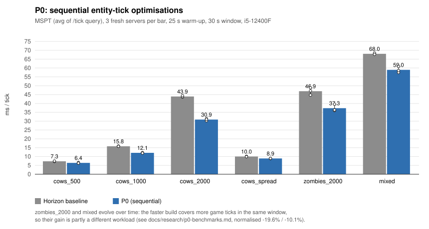
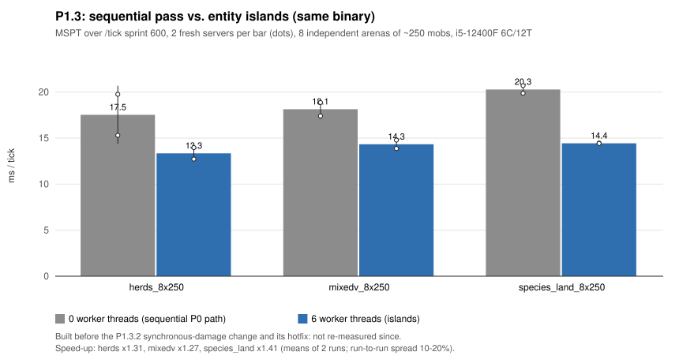
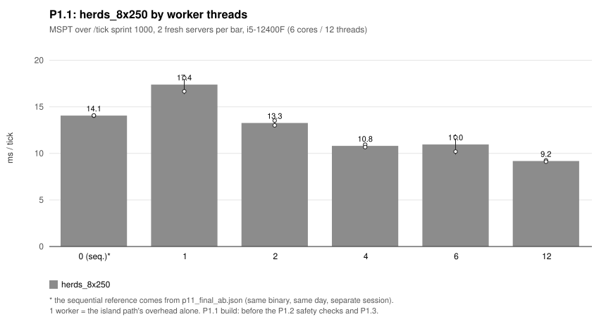
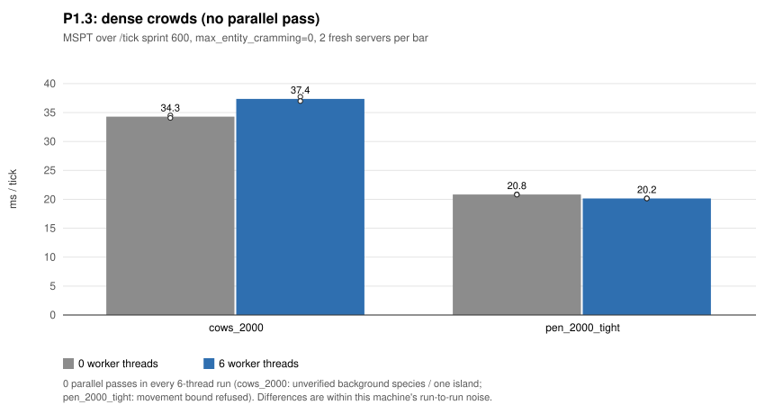

# Voxaryn parallelism progress: Entity Islands (P0–P1.3.2)

> **Status: experimental.** The parallel mob pass is off by default: it is compiled
> only with the cargo feature `parallel-entities` and runs only when
> `HORIZON_ENTITY_THREADS` is set. Without both, the game runs the sequential
> path. All numbers below were measured on **one machine** (Intel i5-12400F,
> 6 cores / 12 threads, Windows 11, rustc 1.99.1) with dedicated servers and an
> idle bot. They are not a claim about other hardware, real servers or players.
>
> Branch: `experimental/entity-islands-p1.3`, based on `main` at `ec4780cd`.
> The detailed phase reports (in Russian) are in [docs/research/](docs/research/).
>
> **Which build each number comes from.** The code on this branch is **P1.3.2**
> (P1.3 plus synchronous melee damage and its pending-push hotfix).
>
> - **Performance numbers (§5) are historical.** They were measured on the earlier
>   P0, P1.1, P1.2 and P1.3 builds. **None was measured on P1.3.2.**
> - **Correctness results (§4)** are labelled per row. The parity harness runs, the
>   P1.3.2 `VERIFY` runs, the fault injections, the fast-mob test and the unit tests
>   ran on the P1.3.2 tree. The large `VERIFY=1` series ran on the P1.3 build.
>
> This branch is **not** fully vanilla-compatible. §3 lists the fixes and §7 the known
> divergences.

## 1. Where this comes from

Voxaryn starts from **Horizon**, an open-source re-implementation of Minecraft:
Java Edition 26.3 in Rust by Ludovic and its other contributors
(<https://github.com/ludovic111/horizon>, MIT license). Everything that makes the
game run (world, protocol, rendering, mob AI, the vanilla parity harnesses and their
Java oracles) is Horizon's work. See [PROJECT_ORIGINS.md](PROJECT_ORIGINS.md) and the Git
history for authorship. This branch adds:

- a research track on the server tick;
- one sequential optimisation (P0);
- an experimental parallel pass for mobs (P1–P1.3.2);
- the vanilla-parity fixes that pass needed;
- measurement and test tooling.

Horizon's maintainers are not involved and have not reviewed this work. The work was
done with AI coding agents under the project owner's direction. External reviews by
another agent (OpenAI Codex) found real problems that were then confirmed and fixed:

- the P1.1 audit, including a fast mob crossing islands
  (`docs/research/p1-stabilization.md` §2);
- the P1.3.2 pending-push order.

Mojang's code is not part of this repository. Vanilla behaviour was read from a locally
decompiled 26.3 server, which is kept out of Git. Fixes are written from that
reading, not copied. Pumpkin (GPLv3) was studied for ideas only
(`docs/research/pumpkin-analysis.md`), and none of its code is used.

## 2. What runs in parallel, and what does not

Only the **mob pass** (`Game::tick_creatures`, the loop over living mobs) runs in
parallel. Blocks, block entities, other entities, players, chunks, networking and
saving are unchanged and sequential.

### 2.1 Entity Islands

The mob pass was moved, unchanged, into one function, `mob_pass`
(`game/creatures.rs`). Its inputs (`PassInput`) are read-only and its outputs
(`PassOut`: mobs, snapshot, events, deaths, the level random) are explicit.
On a tick that qualifies, `creatures_parallel::try_pass` does the following:

1. **Gate.** The tick must have enough mobs (`HORIZON_ENTITY_MIN_MOBS`, default 64).
   Every mob must be a *verified species*: one whose tick was audited to touch only
   itself, the snapshot and its own random. That is 15 species: cow, mooshroom, pig,
   sheep, chicken, zombie, squid, glow squid, dolphin, drowned, goat, nautilus,
   skeleton, spider and creeper. No mob may be able to reach the level random
   (`ai::reaches_level_random`). Otherwise the tick runs sequentially.
2. **Movement bound.** Before anything runs, a per-tick step bound `S` is proven
   (`islands::motion_step`). Each mob's speed plus its species' goal speed and extras,
   plus 0.05 for each mob that could push it, must stay ≤ `S`, found as a fixed point.
   It is refused above `STEP_MAX` = 3 blocks/tick and for unbounded cases (a fleeing
   squid). A refused proof makes the tick sequential and skips the proof for
   20 passes.
3. **Plan.** Union-find over XZ columns of size
   `R = max(follow_range, 16) + margin(S)`, with the 8 neighbouring columns.
   Mobs are also linked by their target, hurt-by and goal-held mob (a breeding
   partner is held by id at any distance). Each connected group is an
   **island**. Fewer than two islands, or one island holding ≥ 75 % of the ticking
   mobs, means sequential.
4. **Run.** Each island runs the same `mob_pass` on private copies of its mobs and
   snapshot, on a bounded rayon pool (`HORIZON_ENTITY_THREADS`).
5. **Merge.** Mobs, events, deaths and guest events are merged back **in the
   original mob order** through per-mob marks. The result has the same shape as the
   sequential pass's.

### 2.2 Guard, rollback and VERIFY

- **Guard.** A copy of the pass state (mobs, snapshot, died set, bindings, level
  random) is taken before the islands run. After the run the pass checks:
  - every mob moved no more than `S` along x and z;
  - no island drew from the level random;
  - no island left a write for a mob of another island (P1.3.1). Such writes are a
    hit, an alert, a push, a brain memory or a bred partner's rest.

  If any check fails, the parallel result is thrown away, the tick is **redone
  sequentially from the copy**, and the parallel pass is turned off until restart.
  An unproven result never reaches the world.
- **VERIFY.** `HORIZON_ENTITY_VERIFY=N` also runs the sequential pass on copies for
  every N-th parallel pass and compares bit for bit: every mob's `Debug` digest,
  events, guest events, dead mobs, the died set, bindings and the level random. On a
  difference it logs and keeps the sequential result. It checks one step from the
  current state, so `N=1` is needed for a full check.
- **Test-only knobs** exist only in builds with `parallel-entities-unsafe-test`:
  - `HORIZON_ENTITY_UNSAFE_REACH`, `_NO_MOTION_BOUND`, `_NO_GUARD`, `_SPECIES`;
  - fault injection `_INJECT=attack|attack_same|target|push|pushed_attack:N`.

  They exist to prove the checks catch what they should.

### 2.3 Hits inside the attacker's tick (P1.3.2)

Vanilla applies a melee hit (`Mob.doHurtTarget` → `target.hurtServer`) inside the
attacker's tick. `mobs/victims.rs` lends the pass's other mobs to the ticking mob
(`PassVictims`, split around it). A hit therefore lands at once: health, hurt
cooldown, default knockback, sounds and death. A target outside the pass falls back
to the old `AttackMob` event, and for another island that trips the guard. The
P1.3.2 hotfix applies the target's **already pending pushes** first, in order and
once each, because vanilla's `Entity.push` had already moved it before the hit.

## 3. Vanilla parity fixes in the sequential pass

Islands must equal the sequential pass, and the sequential pass should equal vanilla
26.3. It does not yet do so everywhere: of 162 `mob_ai` scenes, 154 match vanilla
entirely and 8 still diverge (§7). The other harnesses that cover mobs were not run
(§4). These fixes change the **sequential** game too. Each is checked against the real
26.3 server by Horizon's `mob_ai` / `server_entities` harnesses.

| Item | Before | Now |
|---|---|---|
| A. Entity cramming | `max_entity_cramming` ignored, no damage, `nextInt(4)` drawn too often | rule, `cramming` damage type and vanilla draw order (3 scenes, with deaths) |
| B. Hits and alerts | applied after the whole pass; later mobs saw stale health, death and target | applied inside the attacker's tick (`bees_alerted`, …) |
| C. Breeding RNG | offspring variant not drawn; XP from the level random; love not reset by damage | vanilla order from the parent's random for cow, pig, chicken, mooshroom and sheep (7 scenes) |
| D. Sheep and `mob_griefing` | rule ignored; eaten grass changed only after the pass | rule honoured; later mobs of the same tick see the change (3 scenes) |
| E. `Motion` on load | components > 10 kept | `Entity.load`: a component beyond ±10 loads as 0 (unit test + `server_entities` TNT) |
| P1.3.2 | melee damage after the attacker's tick | inside it. Scenes `zombie_kills_trader` and `zombie_hits_villager` still diverge later for other reasons (§7). |
| P1.3.2 hotfix | pending pushes applied after the hit's knockback | before it. 3 new scenes diverge without the fix. With it, 2 match entirely; the kill scene matches for the victim, the cows, sounds and RNG, but a separate zombie-look divergence remains at t25 (§7). |

Still open, not fixed (§7): F (push order across entity sections) and G (sin/cos last bit on
Windows; a correctly rounded candidate is in `jmath::rounded`, **not wired in**).

## 4. Tests and checks that were run

All of these were run on the machine above. File names refer to raw results under
`.local/` (git-ignored, not published). Numbers are copied from the logs.

**Parity against vanilla 26.3 (sequential path, P1.3.2 tree):**

| Check | Result |
|---|---|
| `tools/test_mob_ai_parity.py`, 162 scenes | 154 match entirely. The other 8 are known (§7); none is new against the pre-hotfix tree. |
| `tools/test_server_entities_parity.py` | 30 / 30 entities identical |
| Hotfix scenes before / after the fix | `cow_pushes_before_zombie_hit` diverged at tick 63, now all 121 ticks match; `cows_push_before_zombie_hit` diverged at tick 24, now matches |

**Islands against the sequential pass:**

| Check | Result |
|---|---|
| `VERIFY=1` (every pass), P1.3 build, 6 threads, two island orders, 300 ticks: `player_arena`, `species_land_8x250`, `mixedv_8x250`, `effects_breed_8x250` | 2 169 passes compared, 0 differences |
| Same (P1.3 build), after the stranded-write check | 609 passes, 0 differences, check never fired |
| P1.3.2 hotfix tree, `species_land_8x250`, `VERIFY=1`, orders `largest` and `shuffle:7` | 179 + 179 passes, 0 differences |
| P1.3.2 tree: injected same-island hit (`attack_same`), `VERIFY=1` | 100 / 100 passes, 0 differences |
| P1.3.2 tree: injected cross-island hit / push, `VERIFY=0` | detected, one sequential redo, pass turned off |
| P1.3.2 tree, `pushed_attack`: pending push on B, then a cross-island hit on B, `VERIFY=0`, two orders | exactly one redo. The redo equals the sequential reference bit for bit (health, velocity, random, whole pass). B's velocity matches the knockback recomputed with the push applied **once**, not twice or zero times. |

**Negative controls (the checks catch real errors):**

| Control | Result |
|---|---|
| Plan reach forced too small (P1.1 build) | verify catches differences in 60 of 60 ticks |
| P1.3.2 tree: fast mob within vanilla limits (`Motion:[10,0,0]`), protected | movement proof refuses those ticks, 0 differences |
| … without the movement bound | post-pass check fires, tick redone, 0 differences |
| … without bound, small reach, **no guard** | check fires, not redone, verify reports 1 difference (a lost push) |
| P1.2 build: axolotls let through (they use the level random), no guard | 1 difference; with guard: redone, 0 |

**Unit tests and lints (latest tree):**

- `cargo clippy -p horizon-client -- -D warnings` without features, with
  `parallel-entities` and with `parallel-entities-unsafe-test`: clean.
- `cargo test -p horizon-client --lib --features parallel-entities-unsafe-test`:
  1 090 passed, 3 failed. The 3 also fail on untouched `main` on this Windows
  machine: `crash::stacks_start_at_the_panicking_frame`,
  `packs::cache::directory_inputs_config_and_owned_output_recovery`,
  `save::session_lock_is_exclusive`.
- `--bins`: 104 + 18 passed.

**Not run** (do not assume these pass):

- `tools/parity.py` and the other ~100 harnesses that cover `mobs/` and
  `game/creatures.rs` (the runner needs `fcntl`, not on Windows);
- `lan_e2e.py` (symlinks need privileges here);
- `save_roundtrip` / `world_reopen` (need Linux `vscreen`);
- the full `python3 tools/pr_ready.py`;
- Linux and macOS builds;
- any test with real players.

## 5. Performance

### 5.1 Method

- One fresh dedicated server per run (`horizon-client --dedicated`), a fresh world
  (seed 12345), one idle bot (`horizon-bots`) so chunks tick, vanilla game rules
  unless stated.
- A fixed number of game ticks: `/tick sprint N`. **MSPT** = the sprint report's
  milliseconds per tick for the whole server tick, not only mobs.
- Sequential and parallel numbers come from **the same binary**:
  `HORIZON_ENTITY_THREADS=0` (the sequential P0 path) against `=6`.
- Repeats are separate server processes, with thread counts in ABBA order.
- The P0 A/B used `/tick query` averages over a 30 s window after 25 s warm-up,
  3 runs per binary.
- Raw JSON lives in `.local/` and is not published. The runs used are in
  [docs/parallelism/perf-data.csv](docs/parallelism/perf-data.csv), regenerated by
  `py -3 tools/voxaryn/perf_charts.py`.
- Run-to-run spread on this machine is **10–20 %** (P1.3 ABAB series:
  `herds_8x250` at 0 threads ranged 16.8–21.6 ms). CPU frequency was not pinned,
  and only 2–3 repeats were made, so differences of a few percent are not resolved.

### 5.2 P0: sequential optimisation (Horizon baseline against P0)

P0 changed `ai::push_entities` only. It reuses its target list and skips an empty
team-filter pass. Nothing is parallel, and the work per tick is identical (same
candidate counts).



| Scenario | Horizon baseline MSPT | P0 MSPT | Δ |
|---|---:|---:|---:|
| `cows_500` (one pile) | 7.31 ± 0.14 | 6.41 ± 0.21 | −12.3 % |
| `cows_1000` | 15.81 ± 0.11 | 12.10 ± 0.15 | −23.5 % |
| `cows_2000` | 43.91 ± 0.40 | 30.88 ± 0.60 | −29.7 % |
| `cows_spread` (4 × 500) | 10.02 ± 0.13 | 8.92 ± 0.05 | −11.0 % |
| `zombies_2000` | 46.90 ± 2.07 | 37.30 ± 2.00 | −20.5 % (−19.6 % per unit of work) |
| `mixed` (5 species) | 68.03 ± 0.40 | 58.97 ± 1.75 | −13.3 % (−10.1 % per unit of work) |

This series predates P1.3 A: Horizon had no cramming damage then, so the `cows_*` piles
stayed alive. With vanilla cramming (since P1.3 A) most of such a pile dies (§5.5).

### 5.3 P1.3: sequential pass against islands

Eight independent arenas of ~250 mobs (`*_8x250`), 600 ticks, 2 runs each.



| Scenario | 0 threads MSPT (runs) | 6 threads MSPT (runs) | Speed-up | Parallel passes |
|---|---|---|---:|---|
| `herds_8x250` (cows, pigs, sheep, chickens) | 17.53 (15.30 / 19.76) | 13.35 (12.72 / 13.97) | ×1.31 | all |
| `mixedv_8x250` | 18.13 (18.87 / 17.40) | 14.33 (14.79 / 13.87) | ×1.27 | all |
| `species_land_8x250` (zombies, skeletons, spiders, creepers, goats) | 20.29 (19.87 / 20.70) | 14.44 (14.46 / 14.42) | ×1.41 | 527/620, 620/620 (rest: movement bound refused) |

These were measured on the P1.3 build **before** P1.3.2 (synchronous damage) and its
hotfix. Performance was **not re-measured** after them.

### 5.4 Earlier builds and thread count

| Build | Scenario | 0 threads | 6 threads | Speed-up |
|---|---|---:|---:|---:|
| P1.1 (no safety checks yet) | `herds_8x250` | 14.07 | 10.41 | ×1.35 |
| P1.1 | `zombies_8x250` | 15.68 | 10.02 | ×1.56 |
| P1.2 (movement proof + guard) | `herds_8x250` | 14.34 | 11.84 | ×1.21 |
| P1.2 | `herds_1x1000_7x100` (one dominant herd) | 13.75 | 13.66 | none (movement bound refused, sequential) |



P1.1, `herds_8x250`, MSPT by worker threads (2 runs each):

| Threads | 0* | 1 | 2 | 4 | 6 | 12 |
|---|---:|---:|---:|---:|---:|---:|
| MSPT | 14.07 | 17.40 | 13.27 | 10.81 | 10.96 | 9.18 |

\* The 0-thread value comes from a separate session of the same binary. With 1 worker
the island path costs ~3 ms per tick more than the sequential pass. That is the split,
merge and copies (`docs/research/p1-overhead.md`). The safety checks of P1.2 cost about
another 1.4 ms per pass (proof 0.6, guard copy 0.8).

### 5.5 Where islands do not help



- **Dense crowds are one island.** In `cows_2000` (2 000 cows on one spot) every cow
  touches all the others. The pass stays sequential in every run (0 parallel passes).
  0 vs 6 threads: 34.29 vs 37.36 ms in one series, 32.42 vs 32.03 in another, within
  noise. Under vanilla rules (cramming 24) ~1 570 of those cows die before the window,
  and the rest tick in ~2.2 ms. The old 30–44 ms piles are a load that vanilla itself
  does not keep.
- **Tight pens:** `pen_2000_tight` refuses the movement bound and stays sequential
  (20.83 vs 20.16 ms).
- **Unverified species** (bat, fox, axolotl, wolf, villagers…) anywhere in the tick
  keep the whole pass sequential.
- Summed island work grows ×1.75 at 6 threads compared with the sequential pass
  (measured on the P1.1 build). This is not CPU frequency (≤ 4 %), not the allocator
  (mimalloc: same ratio) and not `Arc` refcounts (A/B). Memory bandwidth / L3 is a
  **hypothesis**, not measured.
- Parallelism *inside* one island (P2, speculative ticks with validation) was
  prototyped as a shadow experiment (`p2-speculate`). It was exact, but its measured
  mob-pass time (not MSPT) was only ×1.03–1.13 faster than the sequential pass, and it loses when rollbacks exceed ~10 %. It is **not pursued**
  (`docs/research/p2-speculation.md`).

## 6. Using it

```sh
cargo build --release -p horizon-client --features parallel-entities
HORIZON_ENTITY_THREADS=6 target/release/horizon-client --dedicated ...   # islands on 6 workers
HORIZON_ENTITY_THREADS=6 HORIZON_ENTITY_VERIFY=1 ...                     # also compare every pass (slow: ~1 s/tick)
```

The server log prints `PARSTATS` lines every 20 passes: parallel passes, islands,
timings, fallback reasons, verified passes and mismatches. Benchmarks:
`tools/voxaryn/entity_bench.py` (see `tools/voxaryn/README.md`). The fast-mob
negative test: `tools/voxaryn/repro_fast_mover.py`.

## 7. Known limitations and open issues

1. **Experimental and off by default.** Not tested with real players, LAN guests on a
   parallel host, or long-running servers.
2. **Small speed-ups, narrow scope.** Measured gains: ×1.21–1.56 on the P1.1–P1.3
   builds, ×1.27–1.41 on P1.3, on one machine, only for separate groups of verified
   species. Dense crowds, pens and mixed worlds with unverified species run
   sequentially.
3. **The current code (P1.3.2) has no performance measurement.** Its cost against P1.3
   is unknown. A speed-up on P1.3.2 is not claimed.
4. **Any guard trip turns the pass off until restart.** That is safe, but one rare event
   ends parallelism for the session.
5. **F: push order across entity sections.** Vanilla iterates push targets by 16³
   section, then by entry order; Horizon uses mob order. Crowds on a section border
   differ in the last bit of velocity (`cows_crammed_sections`).
6. **G: `Math.sin`/`cos` on Windows.** UCRT agrees with HotSpot on 96.9 % of arguments
   (`creeper_alone` t92, `breeze_player` t70, two lamb scenes). The correctly rounded
   candidate (99.87 %) is not wired in.
7. Other known `mob_ai` divergences, unchanged by this work:
   - `zombie_kills_trader` t152;
   - `zombie_hits_villager` t22 (villager gossip about the attacker is not ported);
   - a zombie still looks at a target it killed in the air for one tick
     (`cows_push_before_zombie_kill` t25).
8. A melee hit refused by the hurt cooldown is covered by a unit test only, not by a
   vanilla scene.
9. The harness coverage gap in §4 (*Not run*) applies to this whole branch.
10. Measurements: one machine, 2–3 repeats, unpinned CPU frequency, 10–20 %
    run-to-run spread.

## 8. Next steps

- Re-measure P1.3.2 against P1.3 with more repeats and a pinned CPU frequency.
- Run the full parity set (`tools/parity.py --changed origin/main`) on Linux CI, plus
  `lan_e2e` and the save harnesses.
- Verify more species (bat, fox, axolotl brain without the level random, wolf), so
  mixed worlds stop falling back.
- Fix F with deterministic per-section entry order, which islands must reproduce.
- Lower the island overhead: split/merge allocation, guard copy cost.
- Parallelism *between* tick phases, the next target. The rest of the server tick is
  4.7–6.9 ms sequential in these scenes.
- Decide whether a guard trip should back off instead of disabling the pass.

## 9. Files

| Area | Files |
|---|---|
| Parallel pass | `crates/horizon-client/src/game/creatures_parallel.rs`, `mobs/islands.rs`, `mobs/victims.rs`, `game/creatures.rs` (`mob_pass`, `PassInput`/`PassOut`) |
| Sequential fixes / P0 | `mobs/ai.rs`, `mobs.rs`, `mobs/world.rs`, `mobs/seen_grid.rs`, `mobs/goals.rs`, `mobs/farm.rs`, `mobs/animal_brain.rs`, `entity_nbt.rs`, `save.rs`, `game/zombie_villagers.rs`, `game/commands/world_cmds.rs` |
| Diagnostics (feature-gated) | `game/alloc_stats.rs`, `game/speculate.rs`, `mobs/spec_probe.rs`, `mobs/path.rs` (stats), `game/levels.rs` (`HORIZON_PATH_STATS`) |
| Candidate, unused | `crates/horizon-core/src/jmath.rs` (`rounded`) |
| Harness | `crates/horizon-client/examples/probe/mob_ai_probe.rs`, `mods/horizon/src/test/java/dev/horizonlab/parity/VanillaMobAiOracle.java`, `tools/test_mob_ai_parity.py`, `tools/test_server_entities_parity.py` |
| Tools | `tools/voxaryn/` |
| Reports | `docs/research/` (Russian), `docs/parallelism/` (charts, data) |
