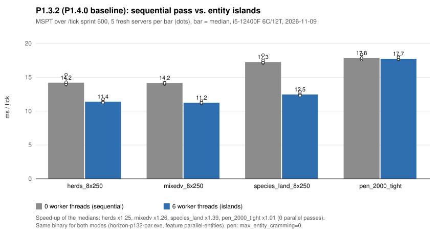
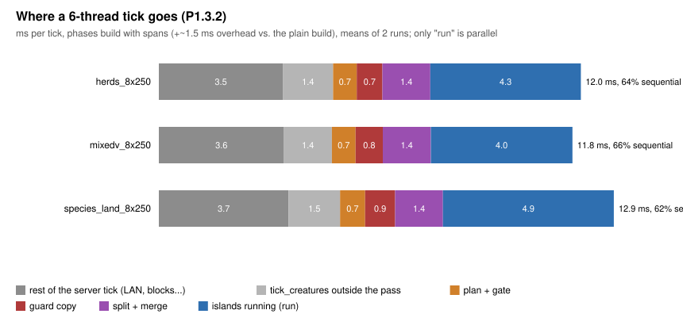
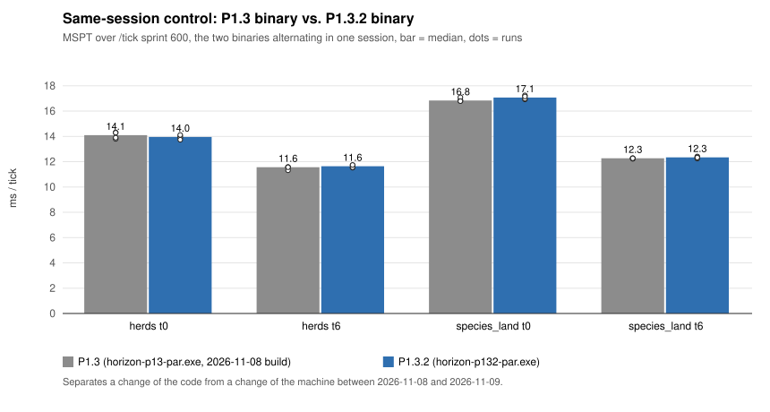

# P1.4.0: базовые измерения P1.3.2 и узкие места

> Фаза P1.4.0, 2026-11-09. Ветка `experimental/entity-islands-p1.4`
> (создана от `1c7942a7`, без изменений кода). i5-12400F 6C/12T, Windows 11,
> rustc 1.99.1. Сервер `--dedicated`, свежий мир (seed 12345), один idle-бот,
> правила `entity_bench.py` (`spawn_*`, `mob_griefing`, `advance_time` выключены).
> Во время замеров не шли сборки; dev-server и клиент к началу замеров уже
> не работали (клиент закрыт в 16:48, dev-server завершился после этого, не
> по моей команде). Сырые данные: `.local/voxaryn-bench/p14_*.json`
> (не в Git). Коммитов нет.

## 1. Сборки и методика

| Бинарник | Фичи | SHA-256 (12) | Для чего |
|---|---|---|---|
| `.local/baseline/horizon-p132-par.exe` | `parallel-entities` | `F2DF59570090` | все замеры MSPT, 0 и 6 потоков — один и тот же файл |
| `.local/baseline/horizon-p132-phases.exe` | `parallel-entities,phase-spans` | `B7809FF764C0` | только разбор по фазам (`--spans`); его MSPT не смешивается с основными |
| `.local/baseline/horizon-p13-par.exe` | `parallel-entities` | `129F33CF37C4` | исторический P1.3, только контроль в той же сессии (§4) |

Сборки: `CARGO_TARGET_DIR=.local/p14-target` и `.local/p14-spans-target`,
`cargo build --release --locked -p horizon-client --bin horizon-client`.

- Окно: `/tick sprint 600`, MSPT — отчёт спринта (весь тик сервера).
- 5 независимых повторов на режим, каждый — новый процесс сервера и новый
  мир; порядок потоков ABBA (0,6 / 6,0 / …).
- p95: после спринта 20 с при 20 TPS, `/tick query` (перцентили последних
  100 тиков) 4 раза, среднее; в таблице — медиана по 5 повторам.
- `pen_2000_tight` с `max_entity_cramming=0`, как в P1.3 (иначе давка
  меняет число мобов); остальные сцены — правила vanilla (толпы < 24).
- Числа мобов равны между режимами (колонка «мобов»).

## 2. Итоговая таблица

| Сцена | Потоки | MSPT, 5 повторов | Медиана | σ | p95 при 20 TPS | Параллельных проходов | Мобов | Ускорение медиан (95 % bootstrap) |
|---|---|---|---:|---:|---:|---:|---|---|
| `herds_8x250` | 0 | 13.98 14.21 13.98 14.27 15.39 | 14.21 | 0.59 | 17.70 | — | 2000 | |
| | 6 | 11.28 11.40 11.68 11.26 11.77 | 11.40 | 0.23 | 14.75 | 100 % | 2000 | ×1.25 (1.20–1.35) |
| `mixedv_8x250` | 0 | 13.99 14.17 14.06 14.22 14.19 | 14.17 | 0.10 | 19.08 | — | 2003–2014 | |
| | 6 | 11.25 11.16 11.33 11.48 11.25 | 11.25 | 0.12 | 14.65 | 100 % | 2003–2005 | ×1.26 (1.23–1.27) |
| `species_land_8x250` | 0 | 17.26 17.09 17.18 18.29 17.50 | 17.26 | 0.49 | 22.88 | — | 2004–2013 | |
| | 6 | 12.43 12.54 12.85 12.46 12.30 | 12.46 | 0.21 | 16.77 | 97.9 % (отказы `motion`) | 2002–2011 | ×1.39 (1.34–1.47) |
| `pen_2000_tight` | 0 | 17.62 17.83 17.84 18.30 18.38 | 17.84 | 0.33 | 23.85 | — | 2000–2004 | |
| | 6 | 17.58 17.67 17.73 18.01 17.95 | 17.73 | 0.18 | 23.07 | **0 %** (`motion`) | 2000–2004 | ×1.01 (0.99–1.04), нет эффекта |



## 3. Куда уходит тик

Сборка с `phase-spans` (её спаны добавляют ~1.5 мс к тику), средние двух
повторов, мс/тик. Спаны рабочих потоков не собираются, поэтому в режиме
6 потоков внутренность островов видна только через PARSTATS.

### 3.1 Последовательный проход (0 потоков)

| | herds | mixedv | species_land | pen_2000_tight |
|---|---:|---:|---:|---:|
| тик (спан) | 15.69 | 15.81 | 19.09 | 21.12 |
| вне мобов (LAN-трекинг 1.3–1.5, блоки 0.8, прочее) | 3.43 | 3.46 | 3.64 | 3.63 |
| `tick_creatures` | 12.25 | 12.34 | 15.44 | 17.48 |
| — `mob_tick` (все мобы) | 9.89 | 9.96 | 13.01 | 13.37 |
| —— `p_travel` (движение, коллизии) | **6.80** | **6.26** | **6.90** | **8.44** |
| —— `p_push` (из него `p_push_query`) | 1.16 (0.82) | 1.15 (0.82) | 1.23 (0.92) | **2.89 (2.46)** |
| —— `p_ai` / `p_goals` | 0.72 / — | 1.34 / 0.88 | 3.57 / 3.08 | 0.79 / — |
| —— `p_base` | 0.70 | 0.63 | 0.71 | 0.76 |
| — `tick_creatures` вне `mob_tick` (снапшот `seen`, события, смерти, снаряды…) | 2.36 | 2.37 | 2.43 | 4.11 |

### 3.2 Острова (6 потоков)

| | herds | mixedv | species_land |
|---|---:|---:|---:|
| тик (спан) | 12.02 | 11.77 | 12.94 |
| вне мобов | 3.53 | 3.56 | 3.69 |
| `tick_creatures` вне прохода | 1.43 | 1.36 | 1.46 |
| план островов (`plan` + `gate`) | 0.67 | 0.67 | 0.72 |
| копия Guard | 0.73 | 0.77 | 0.85 |
| `split` + `merge` | 0.57 + 0.79 | 0.57 + 0.79 | 0.57 + 0.79 |
| **острова (`run`)** | **4.28** | **4.03** | **4.86** |
| — критический путь (самый большой остров) | 2.82 | 2.67 | 3.13 |
| — самый загруженный поток (`busy_max`) | 4.20 | 3.94 | 4.79 |
| — суммарная работа островов | 18.91 | 17.84 | 21.32 |
| островов / мобов | 8 / 2000 | 9 / 2003 | 9 / 2005 |
| **последовательная доля тика** | **64 %** | **66 %** | **62 %** |



Основной MSPT-бинарник (без спанов) даёт те же PARSTATS в пределах 0.1–0.3 мс
(herds: plan 0.57, guard 0.67, split 0.55, run 3.90, merge 0.77, gate 0.07).

## 4. Сравнение с историческим P1.3

Против чисел P1.3 из `p13-regressions.md` (2026-11-08, по 2 повтора) P1.3.2
быстрее на 12–22 % в **обоих** режимах. Это не улучшение кода: в той же
сессии бинарник P1.3 даёт те же числа, что и P1.3.2.

| Сцена | Потоки | P1.3, 4 повтора | медиана | P1.3.2, 4 повтора | медиана | разница |
|---|---|---|---:|---|---:|---:|
| `herds_8x250` | 0 | 14.31 14.29 13.80 13.90 | 14.09 | 14.01 13.90 14.11 13.74 | 13.96 | −0.9 % |
| | 6 | 11.58 11.56 11.32 11.56 | 11.56 | 11.72 11.53 11.56 11.74 | 11.64 | +0.7 % |
| `species_land_8x250` | 0 | 16.80 16.88 17.09 16.79 | 16.84 | 16.92 17.24 16.99 17.16 | 17.07 | +1.4 % |
| | 6 | 12.27 12.23 12.27 12.27 | 12.27 | 12.41 12.24 12.35 12.33 | 12.34 | +0.6 % |



Выводы:
- сдвиг относительно 2026-11-08 — состояние машины (разброс того дня 10–20 %,
  `herds` t0 тогда 15.3 и 19.8), а не код;
- цена P1.3.2 (синхронный урон и применение ожидающих толчков) не выше
  ~1.5 % и этим числом повторов не разрешается; знак не устойчив;
- ускорение островов в пределах прежнего: P1.3 ×1.31 / ×1.27 / ×1.41,
  P1.3.2 ×1.25 / ×1.26 / ×1.39, с перекрывающимися интервалами.

## 5. Узкие места

1. **Последовательная часть — 62–66 % тика даже при 8–9 островах.** Если бы
   острова считались мгновенно, тик стал бы ~7.7 мс (спаны), т. е. потолок
   этой схемы — около ×2 к последовательному проходу.
2. **Накладные расходы прохода ≈ 2.8 мс на тик** (план 0.6, Guard 0.7–0.85,
   split 0.57, merge 0.79, gate 0.07). Это сопоставимо со всем выигрышем:
   t0−t6 в основном бинарнике 2.8 (herds), 2.9 (mixedv), 4.8 мс (species_land).
3. **Квантование расписания.** 8–9 равных островов на 6 потоках: двум потокам
   достаются по два острова, `run` ≈ `busy_max` ≈ 1.5× критического пути
   (4.28 против 2.82 мс в herds). ~1.4 мс теряется на ожидании.
4. **Раздувание работы ×1.8–1.9**: острова суммарно работают 18.9 мс против
   ~9.9 мс `mob_tick` последовательно (P1.1 мерил ×1.75; причина — гипотеза
   о памяти/L3, не измерено).
5. **`p_travel` — 55–70 % тика моба** во всех сценах. В режиме 6 потоков он
   внутри островов, так что на MSPT островов влияет меньше, чем на
   последовательный режим.
6. **Плотный загон не параллелится вообще**: доказательство шага отказывает
   (`motion`) на всех проходах; там дороже всего толчки (`p_push_query`
   2.46 мс, ~5000 целей толчка за тик).
7. **`tick_creatures` вне `mob_tick`** — 1.4–2.4 мс (в загоне 4.1),
   последовательно в обоих режимах; спанов там нет, что именно стоит —
   не измерено.

## 6. Гипотезы для P1.4.1

### H1. Снизить накладные расходы прохода (split, merge, Guard, план)

- **Наблюдение:** ~2.8 мс/тик чисто последовательной работы прохода,
  вне островов; split + merge 1.36 мс — в P1.1 (`p1-overhead.md`) это было
  в основном выделение памяти (mimalloc −35 %).
- **Ожидаемая польза:** если вдвое — около −1.4 мс/тик на `*_8x250`
  (herds ~11.4 → ~10.0 мс, ×1.25 → ~×1.42). Оценка, не измерение.
- **Риск для Vanilla:** семантику не меняет (перенос данных); риск — ошибка
  в слиянии или копии Guard, т. е. корректность параллельного прохода, а не
  отличие от vanilla. Последовательный путь не затрагивается.
- **Минимальная проверка:** переиспользовать буферы островов между тиками
  (ёмкости `Vec`, перенос мобов без слотов `Option`), не трогая Guard;
  A/B 5 повторов herds/species_land по тем же PARSTATS; `VERIFY=1` 300
  тиков и инъекции `pushed_attack`/`attack`.

### H2. Убрать квантование расписания

- **Наблюдение:** `run` ≈ 1.5× критического пути из-за 8–9 островов на 6
  потоков.
- **Ожидаемая польза:** до −1.4 мс/тик, если `run` приблизится к
  критическому пути. Не гарантировано: SMT-потоки могут увеличить
  раздувание работы (P1.1: 12 потоков 9.2 мс против 11.0 на 6 в herds).
- **Риск для Vanilla:** нет; результат не зависит от расписания
  (проверено `VERIFY` с порядками `largest`/`shuffle:7`).
- **Минимальная проверка, без изменения кода:** тот же бинарник с
  `HORIZON_ENTITY_THREADS=8,9,12`, 5 повторов, сравнить `run`,
  `busy_max`, `work`. Только если выигрыш подтвердится — решать про число
  потоков по умолчанию или разбиение крупных островов.

Не выбраны сейчас: `p_travel` (последовательная оптимизация, другой этап);
загон (нужна новая идея доказательства, P2 уже показал, что граф контактов
не помогает); `tick_creatures` вне прохода (сначала нужны спаны).

## 7. Что не сделано

- Нет p95 для режима спринта — только при 20 TPS после спринта.
- Не мерились `species_water`, `player_arena`, `effects_breed`, сцены с
  непроверенными видами.
- Частота CPU не закреплялась и не записывалась (`--freq` не использовался).
- Контроль P1.3/P1.3.2 — только две сцены по 4 повтора.
- Внутренность островов по фазам (`p_travel` и др. в 6 потоках) не видна.

## 8. Воспроизведение

```powershell
$env:CARGO_TARGET_DIR = "$PWD\.local\p14-target"
cargo build --release --locked -p horizon-client --bin horizon-client --features parallel-entities
Remove-Item Env:CARGO_TARGET_DIR
py -3 tools/voxaryn/entity_bench.py bench --exe .local/baseline/horizon-p132-par.exe `
  --scenarios herds_8x250,mixedv_8x250,species_land_8x250 --threads 0,6 --reps 5 --ticks 600 --steady 20 `
  --out .local/voxaryn-bench/p14_islands.json
py -3 tools/voxaryn/entity_bench.py bench --exe .local/baseline/horizon-p132-par.exe `
  --scenarios pen_2000_tight --threads 0,6 --reps 5 --ticks 600 --steady 20 --rule max_entity_cramming=0 `
  --out .local/voxaryn-bench/p14_pen.json
# фазы: тот же запуск с .local/baseline/horizon-p132-phases.exe, --reps 2 --spans
```
