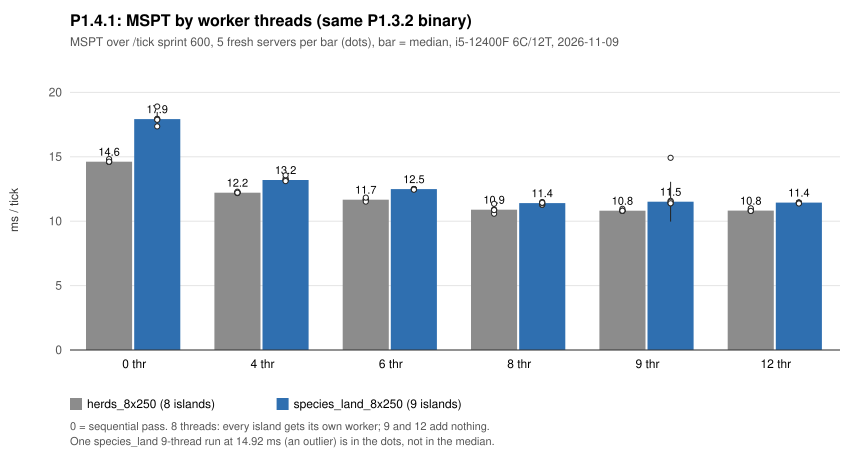
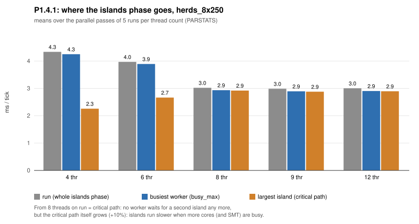

# P1.4.1: число рабочих потоков (проверка H2)

> 2026-11-09, ветка `experimental/entity-islands-p1.4` (без изменений кода).
> Бинарник `.local/baseline/horizon-p132-par.exe` (P1.3.2, `parallel-entities`,
> SHA-256 `F2DF59570090…`), тот же, что в [p14-baseline.md](p14-baseline.md).
> i5-12400F 6C/12T, Windows 11. Сборок и игровых процессов во время замеров
> не было. Сырые данные: `.local/voxaryn-bench/p141_*.json`. Коммитов нет.

## Методика

- `HORIZON_ENTITY_THREADS` = 0 (последовательный проход), 4, 6, 8, 9, 12.
- 5 повторов на режим, каждый — новый сервер и мир; порядок режимов
  чередуется (0→12, затем 12→0, …).
- Окно `/tick sprint 600`; p95 — при 20 TPS после спринта (`/tick query`,
  4 раза по 100 тиков), медиана по повторам.
- Частота: счётчик WMI `% Processor Performance` (относительно базовых
  2.5 ГГц) раз в ~0.9 с во время спринта; сам опрос — фоновый процесс
  PowerShell, одинаковый во всех режимах.
- Распределение островов по потокам в логах не записывается; оно
  выводится из `est` (единиц работы на критический поток), `busy_max` и
  суммы работы `work`.

## Результаты

| Сцена | Потоки | MSPT медиана (σ) | к 6 потокам (95 % CI) | p95 | Частота | Парал. проходов | `run` | `busy_max` | крит. путь | Σ работы | островов / `est` |
|---|---:|---|---|---:|---:|---:|---:|---:|---:|---:|---|
| herds_8x250 | 0 | 14.62 (0.09) | ×0.80 | 18.88 | 160 % | — | | | | | |
| | 4 | 12.21 (0.04) | ×0.96 (0.94–0.97) | 15.45 | 156 % | 100 % | 4.34 | 4.25 | 2.26 | 16.1 | 8 / 4.0 |
| | 6 | 11.67 (0.11) | ×1.00 | 15.03 | 156 % | 100 % | 3.97 | 3.89 | 2.66 | 17.8 | 8.4 / 4.0 |
| | **8** | **10.89 (0.28)** | **×1.07 (1.03–1.10)** | 14.22 | 157 % | 100 % | **3.02** | 2.94 | 2.92 | 21.5 | 8.4 / 8.0 |
| | 9 | 10.81 (0.07) | ×1.08 (1.06–1.09) | 14.25 | 156 % | 100 % | 2.99 | 2.89 | 2.88 | 21.1 | 8.2 / 8.0 |
| | 12 | 10.82 (0.09) | ×1.08 (1.06–1.09) | 15.15 | 156 % | 100 % | 3.00 | 2.90 | 2.89 | 21.4 | 8.4 / 8.0 |
| species_land_8x250 | 0 | 17.92 (0.56) | ×0.70 | 22.82 | 160 % | — | | | | | |
| | 4 | 13.20 (0.18) | ×0.95 (0.92–0.95) | 17.50 | 156 % | 97.9 % | 4.87 | 4.79 | 2.56 | 17.9 | 9 / 4.0 |
| | 6 | 12.49 (0.02) | ×1.00 | 16.05 | 156 % | 100 % | 4.37 | 4.28 | 2.88 | 19.3 | 9 / 4.0 |
| | **8** | **11.40 (0.10)** | **×1.10 (1.09–1.11)** | 16.18 | 156 % | 100 % | **3.30** | 3.20 | 3.18 | 23.0 | 9 / 7.9 |
| | 9 | 11.51 (1.55*) | ×1.09 (0.84–1.10) | 16.43 | 157 % | 99.3 % | 3.49 | 3.36 | 3.34 | 23.9 | 9 / 8.0 |
| | 12 | 11.44 (0.03) | ×1.09 (1.09–1.10) | 16.12 | 156 % | 100 % | 3.34 | 3.22 | 3.21 | 23.4 | 9 / 8.0 |

MSPT, `run`, `busy_max`, критический путь и Σ работы — мс на тик (последние
четыре — средние по параллельным проходам). \* Один прогон 14.92 мс
(выброс, причина не установлена); медиана и CI его учитывают.
Накладные расходы прохода (plan + guard + split + merge + gate) от числа
потоков не зависят: 2.8–2.9 мс (herds), 2.9–3.2 мс (species_land).





## Разбор

**6 потоков действительно ограничивают фазу островов.** При 8–9 островах и
6 потоках `est` = 4.0: самому загруженному потоку достаются два острова,
`busy_max` ≈ 1.46× критического пути, и `run` ≈ `busy_max`. С 8 потоков
`est` = 8.0, у каждого острова свой поток, и `run` сравнивается с
критическим путём (herds 3.02 против 2.92 мс). `run` − `busy_max` (~0.1 мс)
не меняется с числом потоков: это запуск и сбор задач пула, а не ожидание.

**Но выигрыш меньше, чем «один остров вместо двух».** Сам остров при
большем числе занятых ядер считается медленнее: критический путь растёт
2.66 → 2.92 мс (herds, +10 %), 2.88 → 3.18 (species_land, +10 %), сумма
работы — на 21 %. При 8 потоках на 6 физических ядрах часть островов
делит ядро через SMT; частота почти не меняется (156–157 % во всех
параллельных режимах), так что это не троттлинг. Конкуренция за ядро и
кэш/память — гипотеза, не измерено. В итоге `run` падает на ~0.95–1.07 мс
вместо ~1.3–1.5.

**Больше 8 — бесполезно в этих сценах**: островов 8–9, лишние потоки
простаивают (при 12 средняя загрузка потока 1.8–2.0 мс при `busy_max`
2.9–3.2). 9 потоков для 9 островов species_land не лучше 8: девятый остров
маленький, и при 8 потоках `busy_max` уже равен критическому пути.

**p95 при 20 TPS** почти не меняется (herds 15.0 → 14.2, species_land
16.1 → 16.2): хвосты определяются не фазой островов.

## Вывод по H2

H2 подтверждена частично: на этом CPU и в этих сценах 6 потоков
ограничивают фазу островов квантованием. 8 потоков дают устойчивые
−6.7 % (herds) и −8.7 % (species_land) MSPT к 6 потокам, все 5 повторов
лучше любого прогона на 6. 9 и 12 потоков не лучше 8.

Рекомендация для i5-12400F: `HORIZON_ENTITY_THREADS=8` для сцен такого
вида (8–9 островов). Это не универсальная настройка: выигрыш появляется,
когда потоков не меньше, чем крупных островов, а цена (SMT, общий кэш)
зависит от процессора. В другом мире с другим числом островов или на
другом CPU результат нужно мерить заново. Значение по умолчанию в коде
не менялось.

## Переходить ли к H1

Да. При 8 потоках накладные расходы прохода (~2.9 мс: план, Guard, split,
merge) уже равны всей фазе островов (~3.0–3.3 мс) и от числа потоков не
зависят. Это теперь самая большая последовательная часть, которую
добавляет параллельный проход.

## Что не измерено

- Распределение островов по конкретным потокам (не логируется).
- Счётчики кэша и памяти — причина роста критического пути не доказана.
- Другие сцены, другой CPU, привязка потоков к физическим ядрам.

## Воспроизведение

```powershell
foreach ($sc in 'herds_8x250','species_land_8x250') {
  py -3 tools/voxaryn/entity_bench.py bench --exe .local/baseline/horizon-p132-par.exe --scenarios $sc `
    --threads 0,4,6,8,9,12 --reps 5 --ticks 600 --steady 20 --freq --out ".local/voxaryn-bench/p141_$sc.json"
}
```
