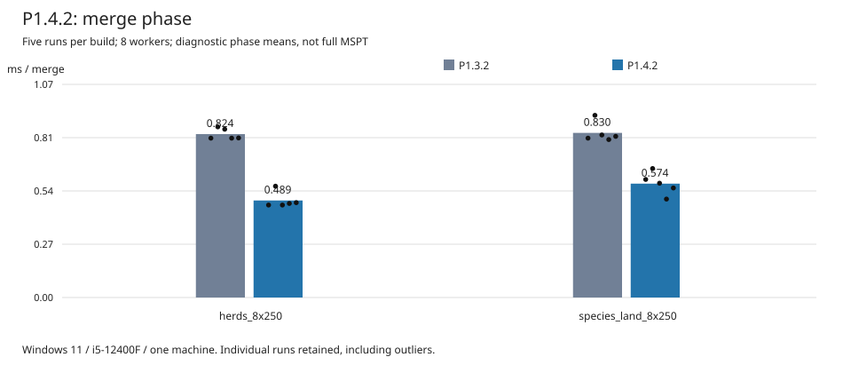

# P1.4.2: буфер merge (H1, первый шаг)

> 2026-11-09, ветка `experimental/entity-islands-p1.4`, не закоммичено.
> i5-12400F 6C/12T, Windows 11, 8 рабочих потоков ([p141-scheduling.md](p141-scheduling.md)).
> Сырые данные: `.local/voxaryn-bench/p142_*.json`, `p142_inject_*.log`.

## Узкое место

Накладные расходы прохода — около 2.8–2.9 мс за тик ([p14-baseline.md](p14-baseline.md)).
Самая дорогая их часть — merge, 0.80–0.83 мс. При этом:

- split переносит `Vec<Mob>` в слоты `Vec<Option<Mob>>`. Аллокация переиспользуется:
  `Option<Mob>` того же размера, что `Mob` (1616 байт), благодаря нише.
- После split все слоты пусты, но их буфер (~3.2 МБ на 2000 мобов, уже
  записанный в этом проходе) живёт без дела до конца функции.
- merge собирает мобов в новый `Vec` (`out.mobs.reserve(n)`), то есть каждый
  проход заново выделяет ~3 МБ и впервые касается всех его страниц на
  серверном потоке.

P1.1 (`p1-overhead.md`) уже показал, что split и merge упираются в аллокации, а
не в число копий: сокращение переносов не помогло, mimalloc дал −35 %.

## Что изменено

Одна функция в `game/creatures_parallel.rs`:

- `reuse_slots(slots, n)` превращает пустые слоты в пустой `Vec<Mob>` с той же
  аллокацией (`into_iter().filter_map(|s| s).collect()` собирает на месте;
  `flatten()` так не умеет, это проверено отдельно, отсюда `allow` для clippy);
- merge собирает мобов в этот буфер вместо нового;
- если вдруг остался непустой слот (split такого не оставляет), возвращается
  новый `Vec`, то есть прежнее поведение.

Порядок слияния, события, Guard, проверки после прохода, повтор (redo),
план и RNG не изменены. Последовательный путь (`HORIZON_ENTITY_THREADS=0`) этот
код не выполняет. Юнит-тест `the_merge_reuses_the_split_slots` проверяет, что
адрес буфера сохраняется, а при непустом слоте берётся новый вектор.

## Замеры

Бинарники P1.3.2 (`horizon-p132-par.exe`, `F2DF59570090`) и P1.4.2
(`horizon-p142-par.exe`, `C24FC9D91952`), оба с `parallel-entities`.
5 повторов на режим, версии и порядок потоков чередуются в каждом повторе,
`/tick sprint 600`.

| Сцена | Потоки | P1.3.2 MSPT (5) | медиана | P1.4.2 MSPT (5) | медиана | старое/новое (95 % CI) |
|---|---:|---|---:|---|---:|---|
| herds_8x250 | 0 | 14.26 16.79 16.22 14.53 14.54 | 14.54 | 14.29 14.30 14.45 14.71 14.51 | 14.45 | ×1.006 (0.99–1.16) |
| | 8 | 10.84 11.37 11.49 10.83 10.64 | 10.84 | 10.09 10.97 10.06 10.15 10.23 | 10.15 | ×1.068 (0.99–1.13) |
| species_land_8x250 | 0 | 18.12 19.75 17.76 17.85 17.88 | 17.88 | 19.06 20.25 18.08 17.86 18.00 | 18.08 | ×0.989 (0.88–1.09) |
| | 8 | 11.26 13.56 11.17 11.32 11.16 | 11.26 | 11.93 12.68 11.23 10.82 11.03 | 11.23 | ×1.003 (0.89–1.21) |

Фазы прохода (8 потоков, средние по параллельным проходам, мс):

| | herds: P1.3.2 → P1.4.2 | species_land: P1.3.2 → P1.4.2 |
|---|---|---|
| **merge** | **0.824 → 0.489 (−0.335)** | **0.830 → 0.574 (−0.256)** |
| merge по прогонам | 0.80 0.86 0.85 0.80 0.80 → 0.47 0.56 0.47 0.47 0.48 | 0.80 0.92 0.82 0.80 0.81 → 0.60 0.65 0.58 0.50 0.55 |
| plan / guard / split | 0.61 / 0.74 / 0.60 → 0.60 / 0.71 / 0.59 | 0.66 / 0.81 / 0.58 → 0.67 / 0.88 / 0.61 |
| run | 3.03 → 3.03 | 3.41 → 3.47 |

- **merge** короче в каждом прогоне: худший новый быстрее лучшего старого.
  Это измеренный эффект изменения.
- **Полный MSPT**: ожидаемый выигрыш ~0.3 мс (2–3 %) меньше разброса этой
  сессии (выбросы до 13.6 и 19.8 мс), все интервалы включают ×1.0.
  Ускорение MSPT **не утверждается**.
- **0 потоков** не изменились в пределах разброса, как и ожидалось: код там не
  выполняется.
- Число аллокаций не мерилось: сборка `alloc-stats` считает только фазу run, а
  её атомики искажают время.

## Корректность

| Проверка | Результат |
|---|---|
| `VERIFY=1`, 300 тиков, 8 потоков: herds и species_land, порядки `largest` и `shuffle:7` | 4 × 300 параллельных проходов, все сверены, 0 расхождений, 0 тревог и повторов |
| Инъекция `attack` (между островами, `VERIFY=0`) | срабатывание, один повтор; цель 20 → 19 HP, `MobHit` 1, неприменённых событий 0 |
| Инъекция `pushed_attack` | один повтор; толчок применён ровно один раз (`after == once true`, twice/none false); HP, скорость, RNG и моб побитово равны эталону; весь проход равен |
| Инъекция `push` | один повтор; скорость цели получила толчок один раз, `MobHit` 0 |
| Инъекция `attack_same` (внутри острова, `VERIFY=1`) | 60/60 сверено, 0 расхождений, без повтора |
| `cargo test -p horizon-client --bins --features parallel-entities-unsafe-test` | 105 + 18 passed (новый тест включён) |
| `cargo test -p horizon-client --lib --features parallel-entities-unsafe-test` | 1090 passed, 3 известных падения Windows |
| clippy `-D warnings` без фич, с `parallel-entities`, с `-unsafe-test` | чисто |

Порядок данных и видимость состояния не меняются: тот же цикл по `owner`
кладёт тех же мобов в том же порядке, меняется только буфер. Поэтому новый
Vanilla Parity тест не нужен; `mob_ai`-харнес параллельный проход и не
использует.

## Решение

Оставить. Изменение локальное (одна функция, тест), семантику не трогает,
merge сокращает на 0.26–0.34 мс стабильно; на полном MSPT эффект пока ниже
порога шума.

## Publication evidence

Per-run values and original JSON SHA-256 hashes are retained in [p14-p21-data.csv](../parallelism/p14-p21-data.csv). Allocation reuse through Vec collection is an implementation property of the tested Rust standard library, not a stable API guarantee. No direct merge allocation counter was collected; buffer identity and timing support the local claim. Linux must run the regression test. Final combined MSPT results belong to [P2.1](p21-shape-translation.md), not this isolated merge experiment.
