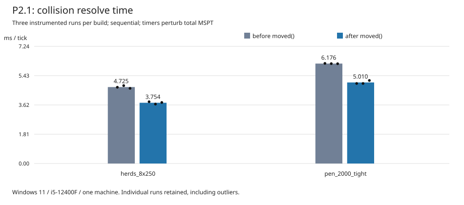
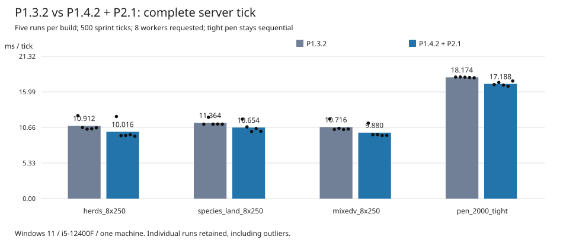

# P2.1 — allocation reduction in VoxelShape::moved

Accepted local collision-kernel optimisation by Kiro, independently reviewed with ACCEPT. This phase changes data ownership and translation construction, not mob scheduling or the order of collision processing.

## Implementation and tests retained

- horizon-core/src/geometry/shape.rs: flatten axis coordinates into Arc<[f64]>, share immutable decomposed boxes through Arc<[Aabb]>, and construct translated coordinates and boxes directly.
- shape/join.rs: use axis_coords for each axis merger.
- shape/face.rs: reconstruct each axis from its own slice when building a face.
- The coordinate-offset unit test checks each axis, unequal axis lengths and exact coordinate bits. The P1.4.2 merge-buffer regression test is retained independently in creatures_parallel.rs.

The translated axes still add each offset exactly once in the same order. Occupancy sharing, box order, fresh nonempty shape identity, empty-shape behaviour and face-cache ownership are preserved. Arc holds immutable slices; no new shared mutable data or unsafe code is introduced. This kernel also serves player movement and world collision queries, so validation must extend beyond mobs.

## Measurements specific to P2.1

Machine: Windows 11, i5-12400F 6C/12T, rustc 1.99.1. Source series: .local/voxaryn-bench/p21ab. Five alternating-version repetitions, fresh worlds, 400 sprint ticks after warmup 40, no resolve timer for MSPT. Tight pen: max_entity_cramming=0. Sequential mode in both versions.

| Scene | Before, all MSPT runs | After, all MSPT runs | Median before → after |
|---|---|---|---|
| herds_8x250 | 14.61, 14.32, 15.33, 14.80, 14.66 | 14.09, 13.41, 13.49, 13.93, 13.66 | 14.66 → 13.66 ms |
| pen_2000_tight | 18.94, 18.40, 18.57, 18.54, 18.69 | 17.23, 18.68, 17.05, 17.17, 17.44 | 18.57 → 17.23 ms |

Separate instrumented resolve runs (three per version): herds 4.714 / 4.815 / 4.646 → 3.818 / 3.672 / 3.773 ms; pen 6.188 / 6.173 / 6.168 → 4.948 / 4.948 / 5.133 ms. Mean resolve reduction is approximately 20.6% and 19.0%, respectively. Do not use instrumented full MSPT as an uninstrumented result.

Kiro additionally reported moved+drop about 305 → 145 ns and allocations 7 → 3 per translated shape. The temporary microbenchmark uses best-of-seven timings of two million translations, not a full-tick median. These microbenchmark figures are reported as Kiro's results; an auditable per-repetition timing record was not found and they are not used as the headline claim. The structural allocation reduction is consistent with the representation change. Linux allocator behaviour and performance were not measured.

## Final integration: P1.3.2 vs P1.4.2 + P2.1

Source directory .local/voxaryn-bench/p22ab is a historical experiment label, **not a P2.2 optimisation**. Its PowerShell driver compares horizon-p132-par.exe with horizon-final-par.exe. It alternates old/new order each round, five rounds per scene, 500 sprint ticks, warmup 40, eight requested workers. No new benchmark was run for publication. The public [CSV](../parallelism/p14-p21-data.csv) retains every run, source hash, mob counts and available parallel-pass counts. Fresh-world entity populations can differ through simulation; these are scenario-level measurements, not identical-state replays.

| Scene | Mean MSPT before → after | Mean reduction | Median before → after | Min–max before / after |
|---|---:|---:|---:|---|
| herds_8x250 | 10.912 → 10.016 | 8.21% | 10.60 → 9.45 | 10.41–12.43 / 9.34–12.30 |
| species_land_8x250 | 11.364 → 10.654 | 6.25% | 11.16 → 10.50 | 11.15–12.19 / 10.05–11.90 |
| mixedv_8x250 | 10.716 → 9.880 | 7.80% | 10.42 → 9.58 | 10.35–11.93 / 9.45–11.31 |
| pen_2000_tight | 18.174 → 17.188 | 5.43% | 18.19 → 17.08 | 18.10–18.22 / 16.83–17.62 |

All outliers are retained, including the slow first herds/mixedv round. Five observations on one machine support a local improvement, not a general speed guarantee or a precise population-level confidence interval. The tight pen has zero parallel passes: its improvement comes from the sequential collision kernel, not extra island parallelism. There is no new P2.1 thread-scaling series; [P1.4.1 scaling](p141-scheduling.md) belongs to the earlier baseline.

Binary SHA-256:

- P1.3.2: f2df59570090a3bcf618283281ea9118cfecbe69c031b470926863ca2bca1fe6
- P2.1 base: 57b6eb2d57c8ad38cf693f5091b754c42b676ad01724eeac6b777fbe78ddb65b
- P2.1 opt: 240222431215360b06e5bfc5f4348876f45cc154599fa788095961af8a421cff
- Final integrated parallel: af760d8e060a9528089a53ce331428cc8b08550389126fcc6acb5cc32e05091b

Binaries and game resources stay local. Temporary probes were removed after these measurements. Builds without their disabled diagnostic features execute the accepted production changes; the exact cleaned publication tree has not been rebenchmarked.

## Correctness evidence and failures

Kiro's saved logs, not new publication runs:

- p21_parity_a.log: 22 collision/support/movement harnesses passed. p21_parity_c.log adds successful world_movement and reruns four related harnesses after integration.
- p21_parity_b.log: server_entities passed; mob_ai **failed**, with 154/162 complete scenarios and 105422/108123 matching mob-ticks before first divergence. Before/after byte-identical mob_ai output was reported by Kiro; this is not full Vanilla parity.
- p22v/verify.json: three scenes × two orders × 100 verified passes, zero mismatches. Fault injections attack, pushed_attack and push each redo once; attack_same does not redo. These are safety checks, not exhaustive proofs.
- p22_checks.log: core 107 passed / 3 ignored; world 159 passed / 1 ignored; client bins 105 + 18 passed. Feature-specific client Clippy configurations passed.
- Windows client-lib release: 1087 passed, **6 failed**, 28 ignored. Failures: crash::tests::{a_panic_becomes_a_report, stacks_start_at_the_panicking_frame, the_debug_crash_is_reported_as_vanillas}; gfx::tests::indirect_draws_are_validated_only_in_debug_builds_and_on_directx_12; packs::cache::tests::directory_inputs_config_and_owned_output_recovery; save::tests::session_lock_is_exclusive.
- Windows client-lib debug: 1090 passed, **3 failed**, 28 ignored: stacks_start_at_the_panicking_frame, directory_inputs_config_and_owned_output_recovery, session_lock_is_exclusive.
- Workspace Clippy on Windows fails on unused horizon-server update::tests::scratch (its caller is Unix-only). Excluding horizon-server passed. These failures are disclosed, not fixed in this optimisation publication; this review did not reproduce each on an unmodified baseline.

The prior independent audit compared old/new geometry output byte for byte across empty, sparse, unequal-axis and composite shapes, translations including nonfinite representations, joins, faces and movement queries; a shared-shape four-worker check and 31 isolated geometry/position tests passed. Those were audit runs, not runs performed during publication.

Linux CI, full Vanilla parity, other CPUs, long-running real-player worlds and full-workspace tests remain unverified. See PARALLELISM_PROGRESS.md for the publication-time checks and experimental feature policy.

## Publication-time validation (cleaned source tree)

- cargo fmt --all -- --check: passed.
- cargo test --offline --locked --release -p horizon-core --lib: 107 passed, 3 ignored.
- cargo test --offline --locked --release -p horizon-world --lib: 159 passed, 1 ignored.
- cargo clippy --offline --locked -p horizon-client --all-targets --features parallel-entities-unsafe-test,p2-speculate,phase-spans -- -D warnings: passed. The feature was compiled, not executed as a simulation.
- cargo test --offline --locked --release -p horizon-client --bins --features parallel-entities-unsafe-test: 105 + 18 passed, 3 ignored; the merge-buffer reuse regression passed on the cleaned tree.
- actionlint 1.7.12: all eight workflow files passed static validation. New CI steps explicitly cover Entity Islands Clippy and binary tests; they have not executed on GitHub.
- Local Markdown report links and public-tree policy checked independently for tracked paths and all local Git history: passed. Python and its launcher were unavailable to this session; tools/check_public_tree.py, the Python unit suite and pr_ready.py were not executed. The equivalent path-policy check is not represented as a successful Python-suite run.
- MIT LICENSE and THIRD_PARTY_NOTICES.md are unchanged. No new dependency or Cargo.lock change. Experimental Cargo defaults are unchanged. Original history is retained; no squash, merge or rewrite.
- GitHub PR listing was attempted but blocked by network restrictions. Horizon and unitycoder upstream links resolve; owner GitHub pages could not be independently fetched. No remote is configured in this local checkout.

All 168 initially modified/untracked files were copied and verified in an external local backup before cleanup. IDE metadata is preserved on disk and ignored. Private resources, executables, large logs, benchmark server directories and temporary probes are not staged. A full clean-tree benchmark, full-workspace validation and Linux execution are still outstanding; no new performance run or optimisation was introduced for publication.
