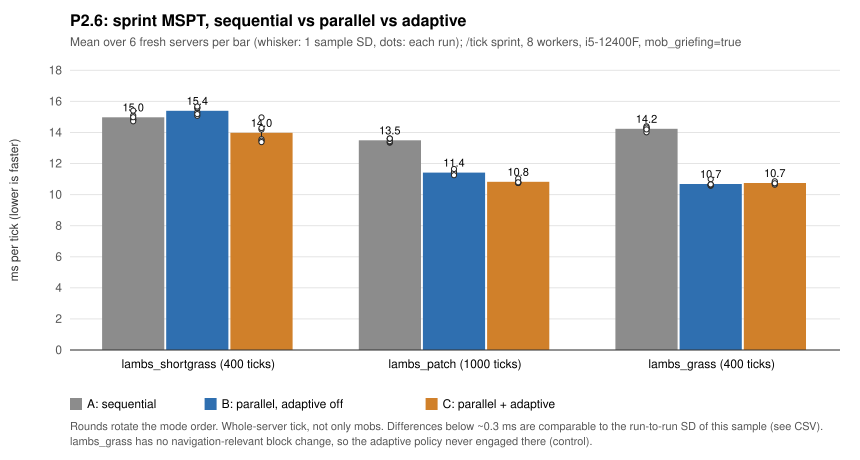
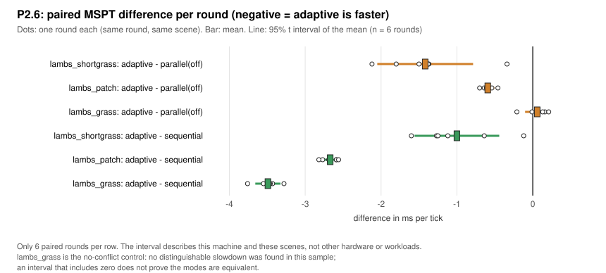
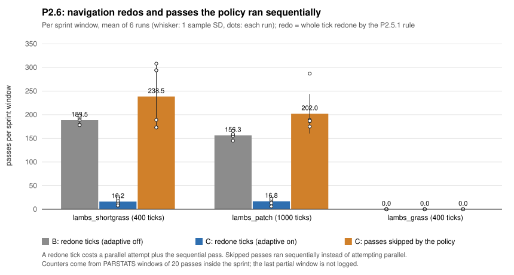
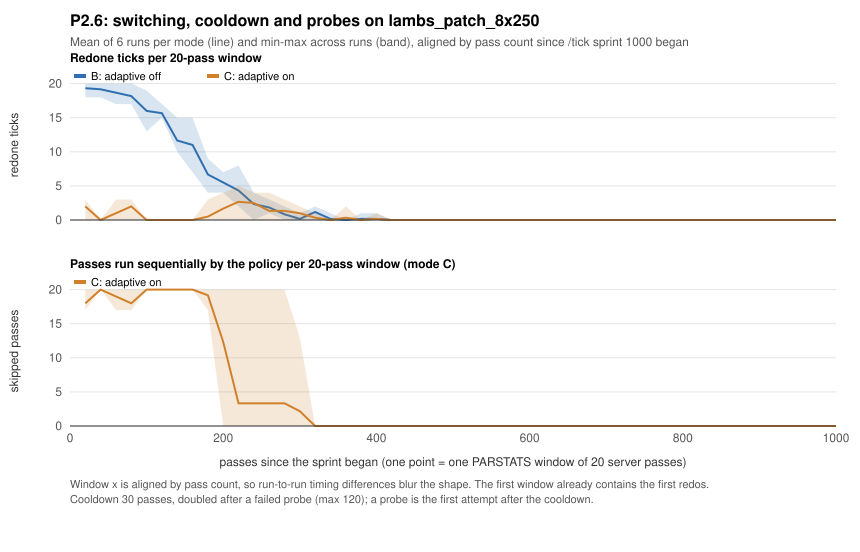
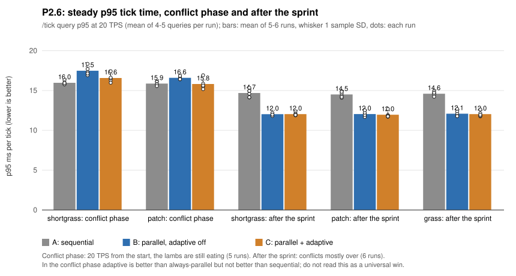
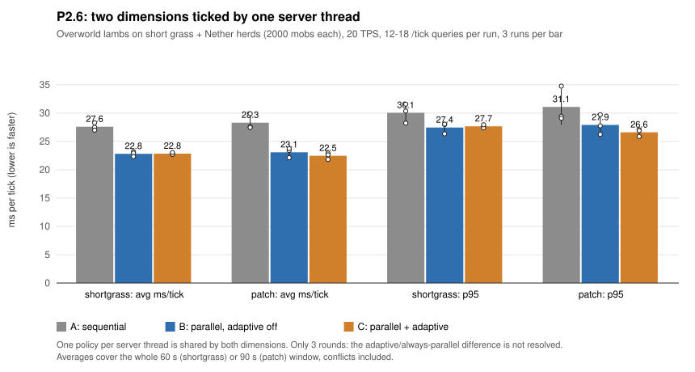

# P2.4–P2.6: block-edit visibility, navigation updates, conservative redo and adaptive scheduling

Status: **experimental, off by default** (cargo feature `parallel-entities`, runtime `HORIZON_ENTITY_THREADS`). Implementation by Kiro (AI agent), independent reviews by OpenAI Codex (AI agent). Committed in `3450cbe5` on `experimental/entity-islands-p2.5`, on top of `80ad4b3c` (P1.4–P2.1). The Horizon base code and its parity harnesses are the work of Ludovic and contributors; see [PROJECT_ORIGINS.md](../../PROJECT_ORIGINS.md).

This report does **not** claim full Vanilla parity, universally faster ticks or production readiness. Every number comes from one machine (Intel i5-12400F, 6 cores / 12 threads, Windows 11, rustc 1.99.1), dedicated servers with one idle bot, and a handful of repetitions. Statements marked **Hypothesis** were not measured.

Contents: [1 Summary](#1-summary) · [2 P2.4](#2-p24-blockedits-visibility) · [3 P2.5](#3-p25-navigation-update-on-block-change) · [4 P2.5.1](#4-p251-conservative-redo) · [5 P2.6](#5-p26-adaptive-scheduling-policy) · [6 Measurements](#6-measurements) · [7 Tests and reviews](#7-tests-and-independent-review) · [8 Limitations](#8-limitations-and-open-questions) · [9 Reproduction](#9-reproduction-and-data)

## 1. Summary

| Phase | What changed | Result |
|---|---|---|
| P2.4 | A mob's block breaks and sets become visible to later mobs of the same tick (`BlockEdits` overlay in `SceneCollisions`) | Reproduced a Vanilla one-tick-late fall; cow now matches 81/81 ticks in all seeds |
| P2.5 | Vanilla navigation recompute on block change (`ServerLevel.sendBlockUpdated` → `PathNavigation.recomputePath`) after a mob's tick; parallel pass redoes the tick when another island's navigation is affected | Ravager navigation matches until an unrelated attack-timing divergence; the check proved insufficient (next row) |
| P2.5.1 | Conservative rule: any block change the navigation reads that happens in the parallel pass makes the whole tick run again sequentially | Safe, but costly where mobs change blocks every tick: on `lambs_shortgrass_8x250` parallel became **slower than sequential** (20.18 vs 17.18 ms, 3 runs each) |
| P2.6 | Adaptive policy: while most recent parallel attempts were redone, run the sequential pass directly; probe again after a cooldown | On the two redo-heavy scenes sprint MSPT is 1.42 ms (−9.2%) and 0.59 ms (−5.2%) lower than always-parallel, and 1.00 ms / 2.67 ms lower than sequential; no statistically distinguishable slowdown was found in the one control where nothing is redone (this does not show equivalence) |

Headline numbers (final series, 6 paired rounds, §6): adaptive − parallel(adaptive off) = **−1.42 ± 0.63 ms** (shortgrass) and **−0.59 ± 0.09 ms** (patch), 95% t interval of the mean, adaptive lower in 6/6 rounds each. Under sustained conflict the **p95** is *not* better than sequential (shortgrass +0.60 ms, patch −0.05 ms, 5 runs, intervals include zero for the patch scene and are wide for both).

## 2. P2.4: BlockEdits visibility

**Reproduced with the real 26.3 oracle** (`tools/test_mob_ai_parity.py`, scenes `ravager_leaves_cow{,_b,_c}`, `cow_ravager_leaves*`, `ravager_leaves_cow_nogriefing*`): a cow standing on leaves that a ravager breaks (`Ravager.aiStep`, `bounds.inflate(0.2)`, including y−1) falls in the same tick if it ticks after the ravager. Horizon fell one tick late because `do_move`'s `SceneCollisions` read the chunk, not the tick's pending edits. The reverse order and the `mob_griefing=false` scenes already matched.

**Change.** `BlockEdits` also stores the state the game will set (`BreakBlock` → air, `SetBlockName` → registry default state). `SceneCollisions` takes `edits: Option<&BlockEdits>` for `collision_block` and the fluid lookup; `do_move` passes the pass's edits, the other ~44 constructors pass `None`. `MobWorld::supporting_block` reads through the edits as well.

**Result.** The cow matches 81/81 ticks in all seeds. The 162 pre-existing scenes were unchanged (their report is identical except for an origin shift caused by inserting scenarios; byte hashes of `horizon.txt` are therefore not comparable across the scene change).

**Not fixed (known):** other `MobWorld` readers (solid, fluid, block name/property, line of sight, pathfinding, friction, movement emission) still read the resident world within a pass; drops, particles, neighbour updates, scheduled ticks and game events are still applied after the pass.

## 3. P2.5: navigation update on block change

**Vanilla behaviour read from the decompiled 26.3 server** (not copied): `Level.setBlock` → `ServerLevel.sendBlockUpdated`: if the empty-context collision shapes differ (`joinIsNotEmpty NOT_SAME`, Horizon `ShapeOp::XOR`), every mob in `navigatingMobs` for which `PathNavigation.shouldRecomputePath(pos)` holds gets `recomputePath()` at once, per block, inside the breaking mob's tick. `Ravager.aiStep` breaks leaves in `BlockPos.betweenClosed` order (x fastest, then y, then z); Horizon looped z innermost (fixed).

**Change.** `mobs::apply_block_changes` processes a mob's `BreakBlock`/`SetBlockName` events one at a time after its tick: record in `BlockEdits`, then `nav::block_updated`. Pathfinding reads `MobWorld::block_now` (edits overlay). Parallel pass: shape-changing positions are noted and `nav::reroutes_elsewhere` looked at other islands' mobs, redoing the tick sequentially without switching the pass off.

**Result.** Ravager navigation matches until an independent ravager melee-timing divergence (reproduced by the control scene `ravager_player_stone`, which has no block changes). RNG never diverged. Saved logs (not re-run for this publication): full `mob_ai` after P2.4: 154/171 scenes match entirely (the 8 known divergences plus 9 new ravager scenes), after P2.5: 154/172. **The full 172-scene run was not repeated on the P2.5.1/P2.6 tree** (only a 14-scene subset in `p251_or.log`: 2/14 match, all remaining differences are the ravager scenes), so current full `mob_ai` status is unverified.

**Limit.** Post-tick application is exact only if the breaker's own navigation tick precedes the break in its tick (true for the ravager, not for a zombie breaking a door in a goal tick). Block changes outside the mob pass (players, explosions, pistons, fluids, doors) still trigger no recompute.

**Why it was not enough for the parallel pass.** `reroutes_elsewhere` checked navigation only before and after the pass and could miss block changes that another island's navigation reads. That led to P2.5.1.

## 4. P2.5.1: conservative redo

Any block change **made in the parallel pass** that **navigation reads** in another island triggers a full sequential redo (the pass stays on; same guard and rollback as P1.2). `navigation_reads_changed` compares collision shape (`ShapeOp::XOR`), path type, state flags and top, fluid, air, solid-render, water name and contextual shape (`BlockCollisionRegistry::contextual`, new). An unproven result never reaches the world.

Consequences measured on the lambs scenes (8 islands × 250 lambs, `mob_griefing=true`):

- `lambs_grass_8x250` (grass → dirt): nothing the navigation reads changes, **0** redos.
- `lambs_shortgrass_8x250` (grass + short grass → dirt / air): every eating tick is redone; VERIFY=1 compared 149/149 parallel attempts with the sequential result, 146 of them redone.
- Cost (3 runs per cell, 200 ticks, `p251perf`): P2.5 (no redo) 13.14 ms, P2.5.1 20.18 ms, sequential 17.18 ms. Always-parallel P2.5.1 is therefore *worse than sequential* here. That is what P2.6 addresses.
- Forced redo on every pass of `herds_8x250` (test knob, 3 runs): 18.92 ms vs 9.26 ms unforced vs 13.29 ms sequential (the sequential samples contain one 15.75 ms run).
- No-conflict A/B (P2.5 vs P2.5.1, ABBA blocks, 8 runs each): herds 9.86 → 9.85 ms; species_land 10.61 → 11.35 ms mean, but median 10.55 → 10.48 ms; the mean is carried by one 17.23 ms P2.5.1 run (sd 2.38). No regression is claimed or excluded beyond that.

## 5. P2.6: adaptive scheduling policy

Source: `crates/horizon-client/src/game/parallel_policy.rs` (behind `parallel-entities`), hooks in `creatures_parallel.rs`. The policy decides **which of two existing, equivalent paths** a pass takes; it reads no game state, no clock and no random source.

| Parameter | Value | Meaning |
|---|---|---|
| `WINDOW` | 16 | outcomes of the newest 16 real parallel attempts |
| `MIN_SAMPLES` | 6 | attempts needed before the window is judged |
| Switch rule | redos × 2 > attempts | **strictly more than half** of the window needed a P2.5.1 navigation redo |
| `PROBE_GIVE_UP` | 3 | a probe whose first 3 attempts were all redone is cut short |
| `BASE_COOLDOWN` | 30 passes | sequential passes after the first switch |
| Back-off | ×2 per failed probe, `MAX_COOLDOWN` = 120 | 30 → 60 → 120 |
| Reset | a full window with at most 4 of 16 redone | next switch uses 30 again |
| Probe | the first attempt after the cooldown, with a fresh window | |

Bypassed (neither decided nor recorded) when `HORIZON_ENTITY_VERIFY > 0`, a fault injection or `HORIZON_ENTITY_UNSAFE_NAV_EVERY` is active, so test runs never pollute the statistics. `HORIZON_ENTITY_ADAPTIVE=0` turns it off. `HORIZON_ENTITY_UNSAFE_ADAPTIVE_VERIFY=1` (test build) keeps it on in VERIFY runs. The log prints `Horizon: adaptive: N of the last M parallel attempts needed a navigation redo; sequential passes now…`; PARSTATS carries cumulative switches/probes and per-window `adaptive=` skips.

The ~54% break-even quoted in the source comments came from the P2.6 tuning runs (redo tick about +5.3 ms vs sequential, clean parallel tick about −6.2 ms on `lambs_shortgrass`). Those tuning runs are not part of the accepted data below. The P2.5.1 series gives the same order of magnitude on other scenes (forced redo +5.6 ms vs sequential; clean parallel −4.0 ms on herds), so the break-even is **scene-dependent**; 50% is a heuristic.

**Shared state (documented limit).** The policy is one `thread_local` per server thread, shared by every dimension that thread ticks. See §6.5.

## 6. Measurements

### 6.1 Which runs are used

| Series (directory) | Purpose | Build | Runs |
|---|---|---|---|
| `p26b` | **accepted** sprint MSPT and steady p95: `lambs_shortgrass` (400 ticks), `lambs_patch` (1000), `lambs_grass` (400) | `horizon-final-p26b-par.exe` | 3 scenes × 3 modes × 6 rounds = 54 |
| `p26bc` | **accepted** conflict-phase p95 at 20 TPS from the start | same | 2 scenes × 3 modes × 5 rounds = 30 |
| `p26bk` | **accepted** no-conflict controls `herds_8x250`, `species_land_8x250` | same | 2 × 3 × 6 = 36 |
| `p26bd` | **accepted** two dimensions in one tick | same | 2 × 3 × 3 = 18 |
| `p26bv`, `p251v`, `p251perf`, `p25v`, `p24v` | VERIFY and fault injection | per phase | 64 results |
| `p25abba`, `p251perf` | P2.4 vs P2.5 and P2.5 vs P2.5.1 A/B | `p24par`, `p25par`, `p251par` | 107 runs |
| `p26`, `p26_v1`, `p26v` | **not used**: earlier P2.6 builds; their steady p95 was taken after the block count had edited the world (Codex finding, fixed in `entity_bench.py`) | | |
| `p26bd_aborted_order1` | **not used**: arena build order made the conflicts end before measurement | | |

Binary SHA-256 (binaries are not published): `p26b-par` `32d66aff5cfdc6c2d5368567fa3b34f0194b2ee7b3261cb218d2b3bb9ec65fe4`, `p26b-unsafe` `c68d3fffaffdb6e644fe8dfe592f479d6597b8c84ae34512cf4cb0d7cafefd79`, `p24par` `5a00c399794c1f9a70a4c4cd4e8a534a50ad3b126ac630824b98c7cc52b5b7eb`, `p25par` `e594afffc394789255c28bd889b59acd479c35920ace948d717a0914eb219ca4`, `p251par` `3b8dfb91d77105d35287e1a45e1cb3b78e121a159e95092e6b92dbb144750fe2`. The `p26b` binaries were built from the working tree before the final `cargo fmt` and a doc-comment change; non-test code is identical to the commit.

**Method.** Fresh dedicated server per run (seed 12345, 8 requested workers, `mob_griefing=true` for lambs), one idle bot. Modes **A** sequential (`HORIZON_ENTITY_THREADS=0`), **B** parallel with `HORIZON_ENTITY_ADAPTIVE=0`, **C** parallel with the policy; one binary, mode order rotated per round. *Sprint MSPT* = `/tick sprint N` report (whole server tick). *Steady p95* = mean of 4–5 `/tick query` P95 values at 20 TPS starting 6 s after the sprint, measured on the untouched scene (the block count that edits the world now runs afterwards; tests in `tests/test_entity_bench_steady.py`). *Conflict-phase p95* = the same query from the start of a 20-tick sprint, while the lambs are still eating; the 20-tick sprint MSPT is not used. Means ± sample SD; paired differences per round; 95% intervals use t quantiles (n = 6 → 2.571, n = 5 → 2.776, n = 3 → 4.303). Intervals are descriptive for these scenes on this machine; they are not a claim about other workloads.

The CSV extracts, the charts and the verification come from `tools/voxaryn/p26_publish.py` (see §9 for what it pins and what it checks). The means, SDs and intervals in this report were recomputed from the CSV extracts (`--tables`); the report text itself is typed by hand and is **not** checked automatically against the CSV.

### 6.2 Sprint MSPT (conflicting and control scenes)

| Scene (sprint ticks) | A sequential | B parallel, adaptive off | C parallel + adaptive | C − B (95% interval) | C − A |
|---|---|---|---|---|---|
| lambs_shortgrass (400) | 14.98 ± 0.25 | 15.40 ± 0.24 | 13.98 ± 0.62 | **−1.42 ± 0.63**, 6/6 | −1.00 ± 0.56, 6/6 |
| lambs_patch (1000) | 13.49 ± 0.12 | 11.42 ± 0.14 | 10.83 ± 0.11 | **−0.59 ± 0.09**, 6/6 | −2.67 ± 0.11, 6/6 |
| lambs_grass (400), no nav change | 14.24 ± 0.13 | 10.69 ± 0.15 | 10.74 ± 0.07 | +0.06 ± 0.16, 2/6 lower | −3.49 ± 0.17, 6/6 |

ms per tick, n = 6 each. On `lambs_shortgrass` always-parallel (B) is **slower than sequential** (+0.42 ± 0.31 ms): that is the P2.5.1 cost; the policy removes it. On `lambs_grass` no statistically distinguishable difference between B and C was found in this sample (+0.06 ± 0.16 ms); an interval that includes zero does not show that the modes are equivalent.

### 6.3 Redo counts and skipped passes

| Scene | B: redone ticks | C: redone ticks | C: passes run sequentially by the policy | C: switches |
|---|---|---|---|---|
| lambs_shortgrass | 188.5 ± 8.3 | 16.2 ± 7.9 | 238.5 ± 66.4 | 3.5 ± 0.5 |
| lambs_patch | 156.3 ± 6.8 | 16.8 ± 6.2 | 202.0 ± 42.0 | 3.2 ± 0.4 |
| lambs_grass | 0 | 0 | 0 | 0 |

Per sprint window (counters come from PARSTATS windows of 20 passes inside the sprint). Total passes per window: about 413 (shortgrass), 1013 (patch), 413 (grass). Switch counts are cumulative over the run.

The timeline aligns six runs by pass count; it shows the policy skipping about 20 of every 20 passes during the first ~200 passes of `lambs_patch` (the 30 → 60 → 120 cooldown sequence), then probing and returning to parallel as the grass patch is eaten (redos drop to ~0 by pass ~400 in both modes). Because runs are aligned by pass count, not time, the exact switch instants blur. Source: `docs/parallelism/p26-timeline.csv`.

### 6.4 p95: where adaptive does not win

| Phase | Scene | A | B | C | C − B | C − A |
|---|---|---|---|---|---|---|
| after the sprint (n = 6) | lambs_shortgrass | 14.69 ± 0.49 | 12.03 ± 0.14 | 12.04 ± 0.19 | +0.01 ± 0.17 | −2.65 ± 0.43 |
| after the sprint (n = 6) | lambs_patch | 14.51 ± 0.34 | 12.04 ± 0.31 | 11.96 ± 0.36 | −0.08 ± 0.24 | −2.55 ± 0.38 |
| after the sprint (n = 6) | lambs_grass | 14.60 ± 0.25 | 12.09 ± 0.36 | 12.04 ± 0.32 | −0.05 ± 0.29 | −2.57 ± 0.34 |
| **conflict phase** (n = 5) | lambs_shortgrass | 15.97 ± 0.22 | 17.48 ± 0.56 | 16.57 ± 0.54 | −0.91 ± 1.11 | **+0.60 ± 0.74** |
| **conflict phase** (n = 5) | lambs_patch | 15.87 ± 0.24 | 16.60 ± 0.20 | 15.82 ± 0.66 | −0.78 ± 1.00 | −0.05 ± 0.85 |

p95 in ms. After the sprint most conflicts are over (steady-phase redos: 0.3 per run at most), so these rows measure the post-conflict state and cannot show the policy's effect; they show only that no distinguishable difference between C and B was found in this sample. Under sustained conflict the policy is better than always-parallel (4/5 runs each) but **not better than sequential** (shortgrass: sequential lower in 4/5 runs). The remaining redo ticks and probes live in the tail. The conflict-phase *average* tick time is lower with the policy (shortgrass 13.11 vs sequential 14.43 vs always-parallel 14.16 ms; patch 12.52 vs 14.21 vs 13.31 ms; all 5/5 runs), so the gain is in the typical tick, not the tail.

### 6.5 Two dimensions share one policy

The Overworld holds the lambs (redo-heavy), the Nether holds 2000 cows in 8 pens (clean); a second bot keeps the Nether ticked. `tick sprint` was not used because the two levels did not tick at the same rate during a sprint (about 1.1 mob passes per tick; cause not investigated), so these are real-time 20 TPS measurements.

| Scene (3 rounds) | A avg | B avg | C avg | C − B avg |
|---|---|---|---|---|
| shortgrass + herds | 27.59 ± 0.65 | 22.81 ± 0.44 | 22.83 ± 0.17 | +0.02 ± 1.51 |
| patch + herds | 28.31 ± 1.36 | 23.08 ± 0.85 | 22.46 ± 0.58 | −0.62 ± 1.05 |

ms per tick over a 60 s / 90 s window. Findings:

- **Measured:** parallel stays clearly faster than sequential in both dimensions even while one of them is redo-heavy; with three rounds the adaptive/always-parallel difference is **not resolved**.
- **Measured and modelled (unit tests):** with one attempt per tick per dimension, the shared window holds at most half redos, so it does not switch for good. If the redo-heavy dimension ticks first, an odd window of 7 attempts holds 4 redos and the policy switches **once** (log line "4 of the last 7"), skips exactly 30 passes (observed: 30 in the VERIFY runs), probes, and then stays parallel. If the clean dimension ticks first it never switches.
- **Cost of sharing:** only while the redo-heavy dimension makes up most of the attempts does the clean dimension also run its mob pass sequentially until the next probe. **Hypothesis:** a per-dimension policy would save about 4 ms per tick during the conflict phase on this scene (redone ticks × 5.3 ms); not measured, not implemented. Cost estimate for implementing it: a map keyed by dimension plus passing the dimension into `try_pass`, with tests; expected benefit exists only for servers where one dimension has persistent block-changing mobs.
- The Nether mob count was equal before and after the window in all 18 runs (2014 or 2015, the cows plus a few non-arena mobs); the count did not change.
- State is carried over when a level is swapped in on the same thread (unit test). Level close/reopen and world reload on a real server were **not** tested.

### 6.6 No-conflict controls and earlier phases

| Scene | A sequential | B | C | C − B |
|---|---|---|---|---|
| herds_8x250 (n = 6), mean ± SD | 12.94 ± 1.54 | 10.09 ± 0.40 | 26.09 ± 39.64 | outlier, see below |
| herds_8x250, **median** | 13.31 | 9.97 | 9.97 | 0.00 |
| species_land_8x250 (n = 6) | 18.15 ± 1.75 | 10.67 ± 0.62 | 10.94 ± 0.77 | +0.26 ± 0.69 |

ms per tick, 300-tick sprints. `herds_8x250` mode C round 5 ran at 107.00 ms/tick for the whole run (sprint, steady p95 335 ms, "can't keep up" messages) with 0 switches, 0 skipped passes and 0 redos; the cause was not identified (a stall of the machine is the most likely, **Hypothesis**). It is kept in the CSV and in the mean; the median is robust to it. Sequential round 1 started with 2070 mobs and ended with 1732, a different workload (9.94 ms). In no control scene did the policy engage (0 switches). For species_land C − B is +0.26 ± 0.69 ms (n = 6); no statistically distinguishable difference was found, which with six runs does not exclude a small slowdown or speed-up.

P2.4 → P2.5 (A/B, ABBA blocks, `herds_8x250` 8 workers, 8 runs each): 9.67 → 9.74 ms; `pen_2000_tight` sequential (16 runs each): 17.60 → 17.75 ms. P2.5 → P2.5.1: see §4. Differences of this size are within the run-to-run spread of this machine (10–20% reported earlier in PARALLELISM_PROGRESS.md; the within-series SDs above are 0.1–0.4 ms).

## 7. Tests and independent review

**VERIFY and fault injection** (`docs/parallelism/p24-p26-verify.csv`, 64 results): every VERIFY run compared each parallel attempt with the sequential pass; **0 mismatches** in all of them, including `lambs_*` with the policy on (adaptive VERIFY, 78 / 19 / 78 / 78 verified attempts), the forced-redo runs and the two-dimension scenes (7–10 verified attempts per run; the slow VERIFY tick limits the passes). Fault injections `attack`, `pushed_attack` and `push` each caused exactly one redo and no later parallel pass; `attack_same` verified 60/60 without redo. These are safety checks, not proofs; the number of passes per VERIFY run is small (100–300).

**Unit tests** (final tree): 17 policy tests (strictly-more-than-half threshold, 8-of-16 and 4-of-7 boundaries, sliding window, cooldown 30 → 60 → 120, probe give-up, recovery, 100 000-step invariant run, a simulated multi-level server loop) plus `a_navigation_relevant_change_redoes_the_tick_once`; client bins 123 passed / 3 ignored with the feature, 99 without; `cargo fmt --check` clean; `clippy -D warnings` clean for the workspace (excluding `horizon-server`, whose Windows-only unused test helper fails as before), `--no-default-features`, `parallel-entities` and `parallel-entities-unsafe-test`. Windows client-lib debug tests: 1091 passed, **3 failed**, the same three as before this work (`crash::tests::stacks_start_at_the_panicking_frame`, `packs::cache::tests::directory_inputs_config_and_owned_output_recovery`, `save::tests::session_lock_is_exclusive`). The Python tests in `tests/` have 3 further failures in `test_port_harness` / `test_port_publish`, files this work did not touch; they were not checked against a clean checkout. The whole workspace is **not** claimed green.

**Codex reviews.** Independent Codex reviews covered the P2.4–P2.6 changes; the P2.5 navigation check was replaced by the conservative P2.5.1 rule after it proved insufficient. The final P2.6 review verdict was ACCEPT WITH NOTES; its notes and their status:

| Note | Status |
|---|---|
| Block count edits the world before steady p95 | Confirmed, fixed (count moved after every measurement; regression tests); old p95 numbers are not used |
| `p26-full.patch` lacked the new `parallel_policy.rs` | Confirmed, a self-contained patch was prepared and applied cleanly to the base |
| Policy shared across dimensions | Confirmed as a performance trait, not a correctness bug; documented, per-dimension policy deliberately not implemented |
| Policy test coverage | Extended (§7) |

## 8. Limitations and open questions

**Measured limits.**
- One machine, one OS, 3–6 paired rounds per cell; unpinned CPU frequency; intervals are descriptive.
- p95 under sustained conflict is not better than sequential (§6.4). The policy helps the typical tick.
- The two-dimension comparison has 3 rounds and does not resolve B vs C.
- Eight requested workers on a 6-core / 12-thread CPU; thread-count scaling for P2.4–P2.6 was not measured.
- Linux and macOS were not run; real players, LAN guests and long-running servers were not tested.

**Correctness and coverage.**
- Not Vanilla-complete: `mob_ai` last full run 154/172 (P2.5 tree), ravager scenes diverge on an independent attack-timing issue; the full run was not repeated on the final tree.
- P2.4/P2.5 limits listed in §2–§3 (other `MobWorld` readers, post-tick application order, block changes outside the mob pass).
- Only the 15 verified species run in parallel; any unverified species in the tick keeps the pass sequential.
- P2.5.1 is conservative by design: it redoes ticks whose block changes are navigation-relevant even when no other island would have been affected. A finer rule is not attempted.
- The policy thresholds are heuristics fitted to lambs-type loads; other block-changing workloads (zombie door breaking, large farms) were not measured.
- Harnesses not run: `tools/parity.py` set (needs `fcntl`), `lan_e2e`, save round-trip harnesses, Linux CI.

**Hypotheses (not measured).** Per-dimension policy gain (~4 ms/tick in the conflict phase of the two-dimension scene); the cause of the 107 ms/tick outlier; why `tick sprint` ticked the second level less often.

## 9. Reproduction and data

| File | Content |
|---|---|
| [p26-data.csv](../parallelism/p26-data.csv) | 138 per-run extracts: series, scenario, round, mode, MSPT, steady avg/p50/p95/p99, redo and skip counters, source JSON name and SHA-256 |
| [p24-p251-data.csv](../parallelism/p24-p251-data.csv) | 107 runs: P2.4 vs P2.5, P2.5 vs P2.5.1, block-change cost, forced redo |
| [p24-p26-verify.csv](../parallelism/p24-p26-verify.csv) | 64 VERIFY / fault-injection results |
| [p26-timeline.csv](../parallelism/p26-timeline.csv) | 602 PARSTATS windows of `lambs_patch_8x250` (modes B, C), source log SHA-256 |
| [p26-manifest.json](../parallelism/p26-manifest.json) | the pinned SHA-256 of all 288 source files and of the 10 published outputs (LF form), and the expected row counts |
| Charts | [p26-mspt](../parallelism/p26-mspt.svg), [p26-adaptive-gain](../parallelism/p26-adaptive-gain.svg), [p26-redo-skips](../parallelism/p26-redo-skips.svg), [p26-p95](../parallelism/p26-p95.svg), [p26-timeline](../parallelism/p26-timeline.svg), [p26-two-dimensions](../parallelism/p26-two-dimensions.svg) |

Raw JSON, logs, binaries and worlds stay under the ignored `.local/`. Publication integrity (`tools/voxaryn/p26_publish.py`):

- The accepted set is fixed in the code **and** pinned in the manifest: the exact run identifiers of every P2.6, A/B and VERIFY source (built from the run design, not from a directory listing; a renamed or substituted run is both "missing" and "unexpected"), and the row counts 138 / 107 / 64 / 602. A missing, extra or modified source stops the run before any published file is touched.
- An ordinary run only verifies: it generates into a temporary directory, checks the prepared files and compares them with the published ones; it never writes to `docs/`. `--install` replaces the published files with a backup and a journal (all or nothing; `--recover` after a killed process; the journal is deleted only after the new files are confirmed, and the backup only after the journal, so an interrupted commit or restore can always be finished or repeated). `--refresh-manifest` is the explicit step that re-pins sources and outputs.
- Checked against the sources: scenario, round and mode (including the run's thread count and adaptive setting), sprint MSPT, steady avg/p50/p95/p99, redo, block changes, parallel and total passes, adaptive switches/probes/skipped passes, steady-phase counters, mob counts, every VERIFY/fault-injection field, and each PARSTATS window of the timeline (re-parsed with separate patterns). Tests: `tests/test_p26_publish.py` (missing source, modified source, no overwrite without a flag, regeneration equals the published files, failure in the middle of an install).
- Not checked automatically: the hand-written tables in this report and in PARALLELISM_PROGRESS.md; the SVG drawings beyond being well-formed and byte-identical to what the pinned CSV regenerates; the benchmark method itself. The raw data is not published, so an outside reader can verify the CSVs only against the SHA-256 values, not re-derive them.

To rebuild and check everything from the raw data: `py -3 tools/voxaryn/p26_publish.py --tables`. Scenes: `lambs_*_8x250`, `twodim_*_herds` in `tools/voxaryn/entity_bench.py`; runs: `entity_bench.py bench --exe … --scenarios lambs_shortgrass_8x250 --threads 8 --ticks 400 --warmup 2 --steady 20 --rule mob_griefing=true --env HORIZON_ENTITY_ADAPTIVE=0|1` (and `--threads 0` for sequential).
